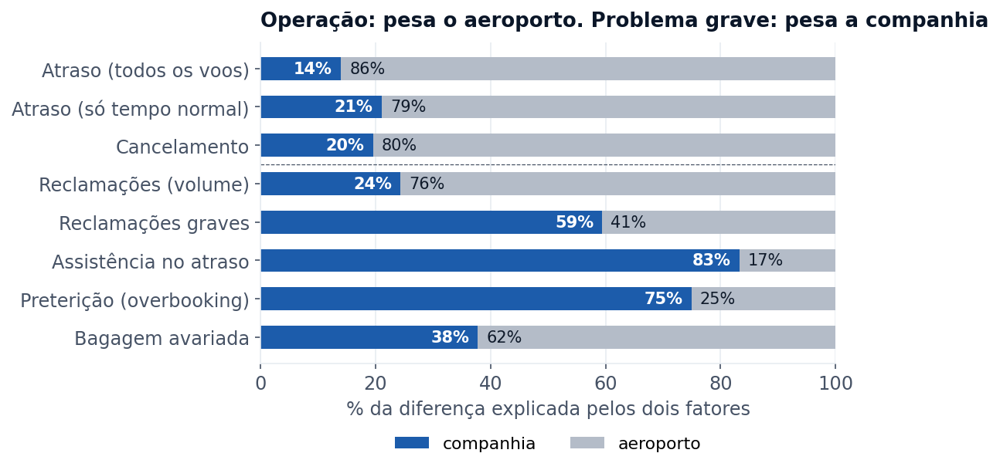
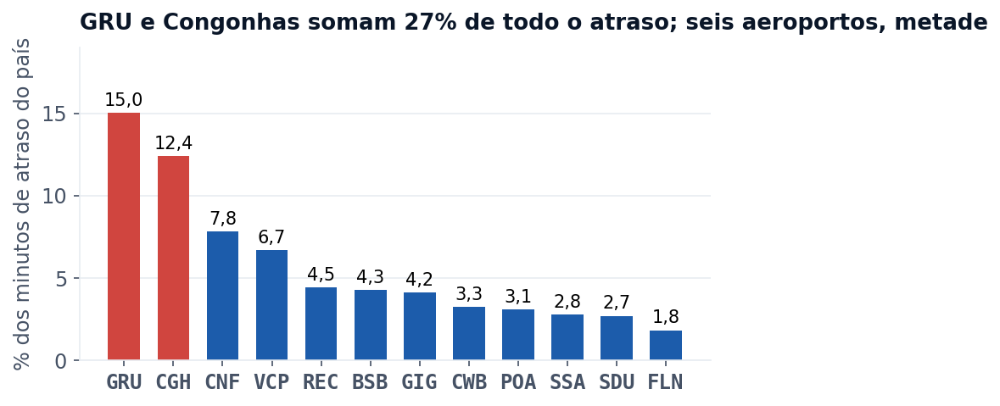
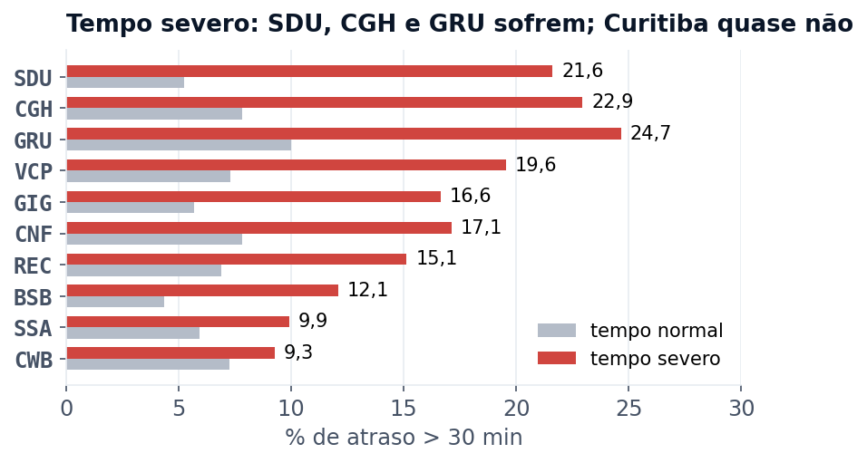
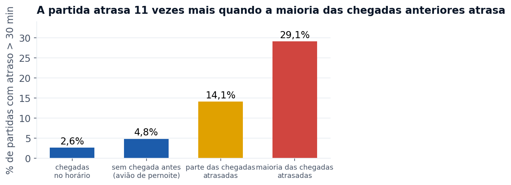
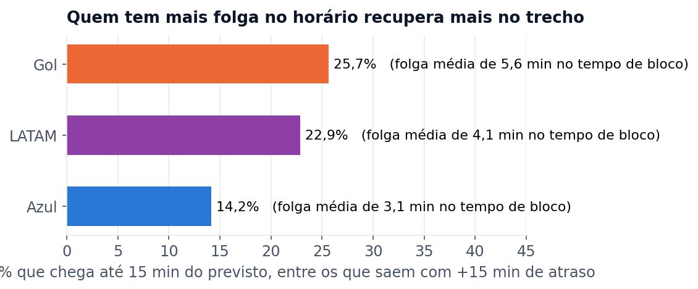
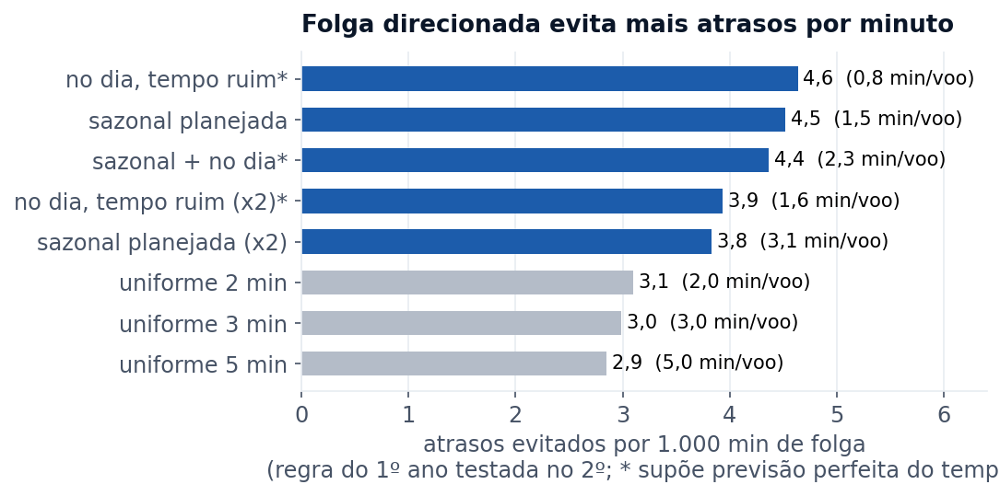
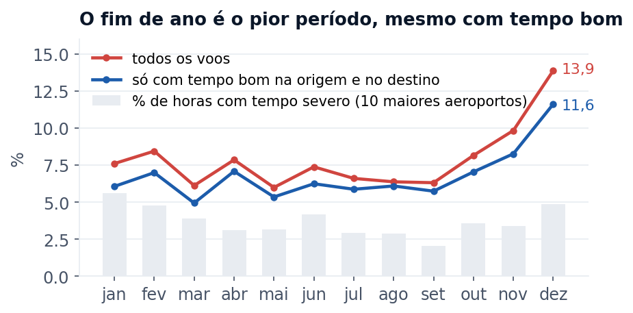
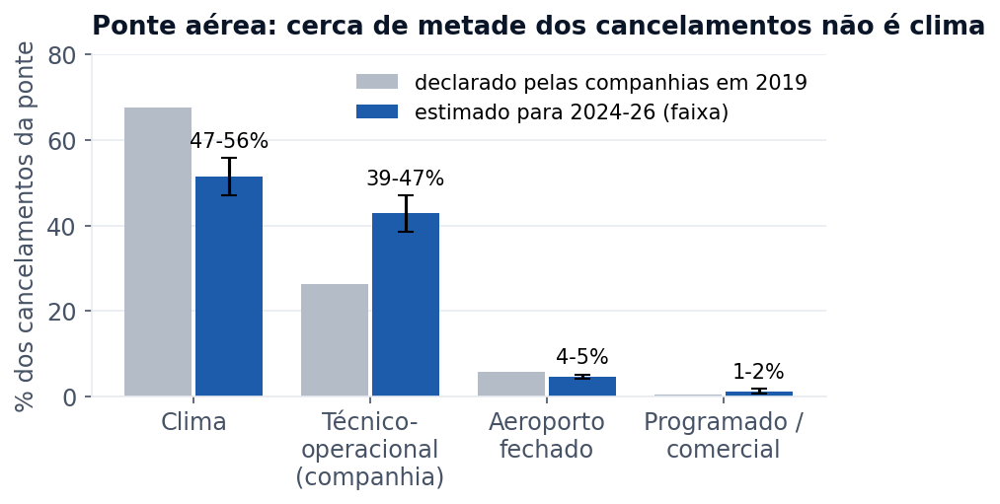
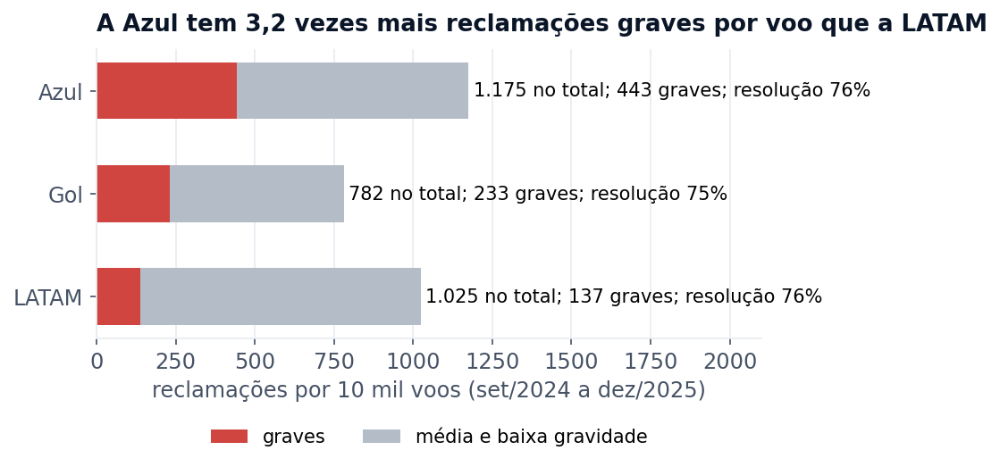
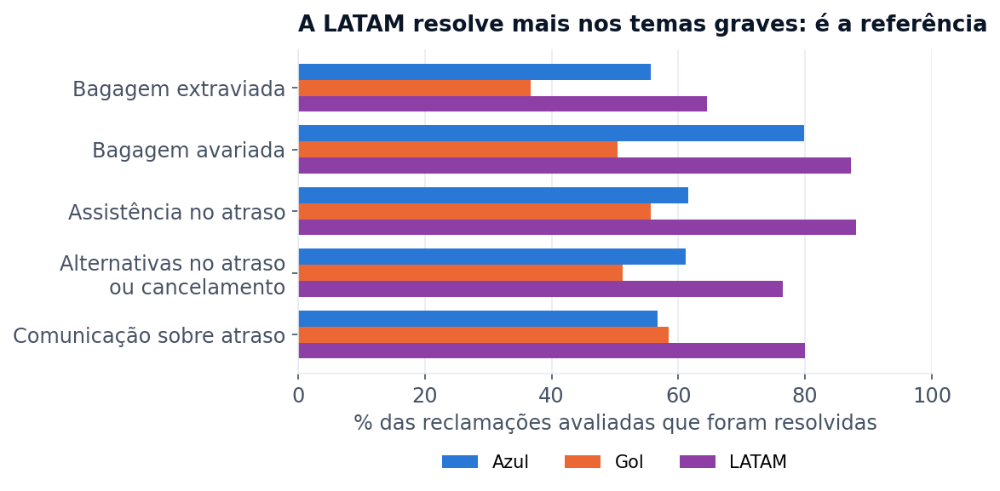

# Atrasos, cancelamentos e reclamações na aviação doméstica: onde uma companhia aérea deve agir (2024-2026)

**Estudo independente** com dados abertos e completos (não é amostra): todos os voos regulares registrados pela ANAC de setembro de 2024 a agosto de 2026 e todas as reclamações do setor aéreo no consumidor.gov.br em 2024 e 2025.

**Autoria:** Fabian Aliatti Mayer definiu as perguntas, tomou as decisões de método e revisou cada resultado. A execução técnica teve apoio de inteligência artificial (Claude), como descrito no Anexo A.

**Para que serve:** orientar a gestão de operações e de atendimento de uma companhia aérea. O relatório mostra onde estão os problemas, quais soluções estudar primeiro e como provar que funcionam antes de ampliar. Nenhuma solução deve ser aplicada sem análise própria de custo e viabilidade. As comparações entre companhias são referência de mercado, não fiscalização.

---

## Sumário executivo

**A situação.** No período, 7,9% das partidas domésticas regulares saíram com mais de 30 minutos de atraso e 2,0% dos voos foram cancelados. Quem atrasou esperou, na mediana, 51 minutos. Somados, foram 8,7 milhões de minutos de atraso, cerca de 5,7 minutos por voo realizado, e cada minuto consome tripulação, manutenção e avião parado.

**Decisão pedida:** aprovar três pilotos antes de qualquer mudança ampla. Em cada um, um sorteio define quais voos ou casos recebem a mudança, e o restante serve de comparação nas mesmas condições. O tamanho e o prazo de cada piloto foram calculados para uma companhia só, para que o resultado seja conclusivo (seção 3).

| Piloto | O que muda | Como se compara | Prazo e menor melhora que se consegue provar |
|---|---|---|---|
| Folga sazonal (solução 4) | Mais minutos de solo e de voo onde e quando o histórico mostra atraso, em Congonhas e Viracopos | Metade das sequências de voos de um mesmo avião (rotações), sorteada na publicação da malha | 180 dias, esperado 1,1 ponto a menos de partidas atrasadas contra o horário publicado (o ganho em hora real é a medida principal, dimensionada com os dados internos). Sorteando voos, provaria a partir de 0,8 a 1,1; sorteando rotações, o mínimo é maior e será recalculado com os dados internos antes de começar. Aos 90 dias, só para parar se não houver sinal ou houver dano |
| Resolução no primeiro contato (solução 1) | Roteiro e autonomia para resolver bagagem e assistência no atraso | Metade dos casos, sorteada na entrada do atendimento; medido nos registros internos | 90 dias: +10 pontos de resolução, com o número de casos refeito pela taxa interna |
| Proteção do tempo em solo (solução 6) | Equipe e recursos dedicados para o avião que chega atrasado, na tarde de GRU, sem tirar a vez dos outros voos | Metade dos números de voo da tarde, sorteada | 180 dias (leitura aos 90 só para parar se houver dano): de 2,1 a 2,2 pontos de atraso na LATAM ou na Gol (na Azul, 5,7, inviável sem incluir mais horários); o efeito máximo possível é 6,6 |

**Ordem de execução:** soluções 1, 2a (investigar os cancelamentos da ponte, com resultado em 60 dias) e 3 já; 4 a 6 em piloto; 7: aprovar até o início de novembro a medição de dez/2026 como linha de base e o orçamento e a contratação para dez/2027 (se houver apetite, um reforço com a equipe atual em bases sorteadas já em dez/2026); 2b decidida com o resultado da 2a; 8 como agenda institucional.

**O que os dados mostram e o que fazer com cada achado**

1. **O atraso nasce em poucos aeroportos e se espalha pela malha da própria companhia.** Da parte do atraso que se consegue explicar, hora e mês pesam mais; da diferença entre Azul, LATAM e Gol, 86% vem do aeroporto, não da companhia. GRU e Congonhas somam 27% dos minutos de atraso do país. Depois, a partida acompanha as chegadas da própria companhia: atrasa 2,6% das vezes quando as chegadas anteriores foram no horário e 29,1% quando a maioria chegou atrasada. 
   **O que fazer:** proteger o tempo em solo nesses aeroportos, para que o atraso pare de passar de um voo para o outro (solução 6).
2. **Os horários têm pouca folga, e quem tem mais folga recupera mais.** Entre os voos que saem com mais de 15 minutos de atraso, 26% dos da Gol chegam até 15 minutos do horário; na Azul, 14%. Com a mesma quantidade de minutos, uma folga direcionada (só onde e quando o histórico mostra atraso) evita quase 30% mais atrasos do que uma folga igual para todos. 
   **O que fazer:** folga por aeroporto, mês e horário, mais reserva nos dias com previsão de tempo ruim (soluções 4 e 5). Na simulação, as partidas atrasadas da rede caem de 8,0% (2º ano) para 7,0%, medidas contra o horário novo; a meta em hora real sai do piloto 1.
3. **O clima pesa, mas não explica o principal.** Cerca de 14% dos atrasos estão ligados a tempo ruim. Mesmo com tempo bom, GRU continua sendo o pior aeroporto, e o fim de ano é o pior período: com tempo bom, dezembro atrasou 10,9% (já sem os dias do vendaval de 2025), contra 6,3% nos meses fora do fim de ano. O pico vai de 1 a 23 de dezembro. 
   **O que fazer:** um plano operacional para 1 a 23 de dezembro (solução 7) e uma agenda com o aeroporto e o controle de tráfego para GRU (solução 8).
4. **Um cancelamento se associa a só 1,3 a 1,7 vez as reclamações de um atraso, mas a ponte aérea cancela 2,4 vezes mais que o resto da rede das três grandes.** Quando cancelar um voo evita atrasar dois ou mais, cancelar tende a gerar menos reclamações. Entre os voos sem tempo ruim, sem incidente no aeroporto e antes das 21h, a ponte cancela 2,8%, contra 1,1% no resto da rede. 
   **O que fazer:** cruzar já os cancelamentos da ponte com o registro de motivos do centro de controle e, se o motivo técnico-operacional se confirmar, criar reserva de avião e tripulação; na rede, decidir entre atrasar e cancelar pesando quantos voos o cancelamento protege (solução 2).
5. **Nas reclamações, a nota depende quase só de resolver, e cada companhia repete os próprios problemas.** Reclamação resolvida recebe nota 4,6; não resolvida, 1,3. O aeroporto define quantas reclamações aparecem, mas a companhia define quais são graves. A Azul tem 3,2 vezes mais reclamações graves por voo que a LATAM (5,0 vezes por passageiro). 
   **O que fazer:** resolver no primeiro contato, copiando o processo da companhia que melhor resolve cada tema, e atacar a origem dos temas que se repetem (soluções 1 e 3). É o caminho mais barato.

---

## 1. Diagnóstico

Cada tema abaixo segue a mesma ordem: o que os dados mostram, por que importa e o que fazer. Os testes estatísticos que sustentam cada número estão no Anexo A.

### 1.1 Onde o atraso nasce

**O que os dados mostram**

- **O aeroporto pesa muito mais que a companhia.** Da variação do atraso que se consegue explicar, a maior fatia vem da hora e do mês. Da parte que muda de uma companhia ou aeroporto para outro, comparando as três grandes nos mesmos aeroportos, horários e meses, o aeroporto explica 86% da diferença de atraso e 80% da de cancelamento. Só com tempo bom, o resultado se mantém: aeroporto 79%, companhia 21%.
- **O atraso está concentrado.** GRU e Congonhas concentram 27% de todos os minutos de atraso do país, e seis aeroportos concentram metade. Entre os aeroportos com mais de uma companhia, GRU é o que mais acrescenta atraso por conta própria (+3,7 pontos; +3,2 só com tempo bom) e piorou do primeiro para o segundo ano.
- **Entre as grandes, a diferença é pequena e estável.** Descontado o aeroporto, a Gol atrasa 1,2 ponto percentual abaixo da média do mercado, a LATAM está na média e a Azul fica 0,7 acima. Nas regionais, a companhia pesa mais: a Azul Conecta cancela 15,6% dos voos.
- **No critério de mercado (A15, chegada até 15 minutos depois do horário), a ordem muda em parte.** Em 2025, chegaram no critério A15 88,5% dos voos da Gol, 85,7% da Azul e 83,3% da LATAM. A LATAM tem mais atrasos pequenos; a Azul, mais atrasos longos. Esses números ficam a menos de 1 ponto do ranking internacional da Cirium, o que é consistente com a base.
- **Tempo severo mais que dobra o atraso.** Com trovoada, chuva forte, visibilidade baixa, teto baixo ou rajada forte no aeroporto, o atraso vai de 7,0% para 17,4% e o cancelamento de 1,6% para 4,5%. No total, 13,6% dos atrasos estão ligados ao clima. O efeito varia muito: com tempo severo, o atraso sobe 16 pontos no Santos Dumont e 15 em Congonhas e GRU, e só 2 em Curitiba, onde o tempo severo é quase todo nevoeiro e teto baixo, que o aeroporto opera bem. Com trovoada ou chuva forte, o atraso sobe 21 pontos em GRU, 25 em Congonhas e 9 em Curitiba.
- **Contexto das companhias no período.** A Gol esteve em recuperação judicial nos Estados Unidos (Chapter 11) até junho de 2025, e a Azul entrou com o mesmo pedido em maio de 2025. A Azul também operou com parte da frota parada para revisão dos motores Pratt & Whitney GTF, o que reduz aviões de reserva. As comparações entre companhias devem ser lidas com esse contexto.

**Por que importa.** A companhia não muda o aeroporto, mas decide quanto do atraso que nasce ali segue para o resto da malha. Com trovoada, GRU e Congonhas sobem mais que o dobro de Curitiba: há espaço para preparar a operação de São Paulo para o tempo convectivo.

**O que fazer.** Concentrar a proteção da operação em GRU, Congonhas, Confins e Viracopos (soluções 5 e 6) e levar ao aeroporto e ao controle de tráfego uma agenda para GRU e para o tempo ruim em SP e RJ (solução 8).

### 1.2 Como o atraso se espalha pela malha

**O que os dados mostram**

- **O atraso cresce ao longo do dia.** A taxa vai de 2,5% às 4h para cerca de 11% na maior parte do período entre 16h e 23h. O primeiro voo do dia de uma companhia num aeroporto atrasa 5,3%; do 31º em diante, 10,3%.
- **Ele acompanha a operação da própria companhia.** O atraso da tarde acompanha o atraso da manhã da própria companhia em outros aeroportos (+3,5 pontos) e no mesmo aeroporto (+2,2 pontos). O atraso das outras companhias no mesmo aeroporto pesa pouco (+0,8 ponto), o que indica que o atraso passa pela rotação de aviões e tripulações, e não só pelo aeroporto.
- **A primeira onda já sai bem.** Os aviões que dormem no aeroporto e saem antes das 10h são 7,3% dos voos e atrasam 3,1%. Se todos saíssem no horário, o atraso do resto do dia cairia cerca de 12%, um ganho do tamanho do da folga, mas difícil de capturar, porque essa onda já está perto do limite.
- **Não há horários "malditos".** Os horários que ficam acima do mercado quase todo mês somam no máximo 7% do atraso. A exceção é GRU às 22h e 23h, com 19% de atraso.

**Por que importa.** O atraso é um problema de escala entre voos, não de um horário ou do primeiro voo. A alavanca principal está no tempo em solo entre um voo e o seguinte. A base pública não traz a matrícula do avião, então a ligação é medida pelas chegadas da companhia no aeroporto; parte dela pode ser um choque comum (fluxo de tráfego, pista) que atrasa chegadas e partidas juntas. A companhia pode medir a propagação exata pela matrícula, com os dados internos de rotação.

**O que fazer.** Proteger o tempo em solo nos aeroportos que originam o atraso (solução 6), com as alavancas usuais do setor: folga mínima de solo por base e horário, tripulação que segue com o avião, avião de reserva no aeroporto principal e troca de aeronave pelo centro de controle. Começar pelo piloto na tarde de GRU.

### 1.3 Folga nos horários e recuperação no trecho

**O que os dados mostram**

- **A margem é pequena.** O tempo de bloco previsto (de calço a calço) embute, em média, 3,1 minutos de folga na Azul, 4,1 na LATAM e 5,6 na Gol, de 3% a 6% da duração do voo.
- **Quem tem mais folga recupera mais no trecho.** Entre os voos que saem com mais de 15 minutos de atraso, chegam dentro de 15 minutos do previsto 25,7% dos da Gol, 22,9% dos da LATAM e 14,2% dos da Azul. No saldo, a Gol chega com 2,7% menos atrasos acima de 30 minutos do que saiu, enquanto a Azul chega com 0,7% a mais.
- **Remarcar voos específicos não resolve.** Quase não há voos que atrasam sempre: mover todos eles para o horário real evitaria só 2,8% dos atrasos.
- **Folga direcionada rende mais.** Com a regra aprendida no primeiro ano e testada no segundo, cada 1.000 minutos de folga evitam cerca de 3 atrasos quando a folga é igual para todos, 4,5 quando é planejada por aeroporto, mês e horário (com 1,6 minuto por voo) e 4,6 quando é aplicada só nos dias de tempo ruim. Com a mesma quantidade (3 minutos por voo), a sazonal evita 3,8 contra 3,0 da uniforme, quase 30% a mais. As duas juntas, com 2,31 minutos a mais por voo em média, levam o atraso do segundo ano de 8,0% para 7,0%. É uma comparação entre estratégias, não uma previsão. Duas premissas: a folga do dia usa o tempo observado (como se a previsão fosse perfeita), então o ganho real será menor; e o atraso é medido contra o horário novo, mais longo.

**Por que importa.** Folga e atraso consomem os mesmos recursos: tripulação, manutenção e aeronave. Como ordem de grandeza, a associação das companhias americanas (Airlines for America) estima o minuto de operação em US$ 98,41 em 2025; o valor não se transfere direto para o Brasil. Na simulação, cada minuto de folga direcionada reduz em cerca de 0,44 minuto o atraso contra o horário publicado. Isso dá ao passageiro um horário mais realista, mas não muda sozinho a hora real de chegada: o ganho operacional vem de cortar a propagação (o voo seguinte sai no horário), que a simulação não mede. Por isso a conta de custo só fecha com o piloto, que mede os minutos reais e a propagação. Do lado do atraso entram, além do custo de operação, a assistência e a reacomodação exigidas pela Resolução ANAC 400, as conexões perdidas e a reputação. Folga em excesso também tem custo: menos uso de cada avião e chegadas adiantadas sem posição livre no pátio.

**O que fazer.** Folga sazonal na malha por aeroporto, mês e faixa horária (solução 4) e reserva no dia com previsão de tempo ruim (solução 5), primeiro em piloto e só onde o histórico mostra atraso.

### 1.4 Picos do ano: dezembro e os dias cheios

**O que os dados mostram**

- **O fim de ano é o pior período, e não por causa do clima.** Juntando os dois dezembros, o mês atrasa 13,9% e cancela 3,2%. Só com tempo bom na origem e sem os dias do vendaval de dez/2025 (que o boletim da origem não captou por inteiro), 10,9%, contra 6,3% nos meses fora do fim de ano. Por ano, com tempo bom: 10,7% em dez/2024 e 11,2% em dez/2025. Em 2024, novembro empatou com dezembro (10,7%); em 2025, novembro foi normal (6,8%). O número de voos por dia varia só cerca de 4% ao longo do ano, e a ocupação não explica: dezembro tem 84% dos assentos ocupados, menos que julho (85%), que atrasa só 6,6%. Os voos extras de fim de ano também não acompanham o atraso.
- **O pico acaba antes do Natal.** De 1 a 23 de dezembro, o atraso fica entre 11% e 15% nos dois anos (fora a semana do vendaval); de 24 a 31, cai para 8,0%, justamente a semana de mais viagens. Isso enfraquece as explicações por volume e por bagagem e aponta para a operação das primeiras semanas do mês.
- **A bagagem explica uma parte.** Dezembro tem 7,8 kg por passageiro, contra 6,6 a 7,2 na maior parte do ano, e cada quilo a mais acompanha cerca de 1,5 ponto a mais de atraso. Mas janeiro tem ainda mais bagagem e atrasa bem menos. O restante do pico continua sem explicação nos dados.
- **Dentro do mês, o dia cheio pesa.** Com 10% a mais de voos no dia, o atraso sobe 2,8 pontos. Quinta e sexta são os piores dias (9,1% e 9,7%), e o fim de semana o melhor (cerca de 6,6%). Nos dias de pico, a manhã não muda; o fim da tarde e a noite pioram de 1,2 a 2,2 pontos.
- **Os cancelamentos se espalham pelo ano.** Os 20 piores dias somam só 11,6% dos cancelamentos. Os dois piores episódios foram o vendaval em São Paulo de 10 e 11/12/2025 e o fechamento da pista do Santos Dumont por vazamento de óleo em 30/09/2025.

*No gráfico, "tempo normal" exige tempo bom na origem e no destino e inclui os dias do vendaval de dez/2025; por isso dezembro aparece com 11,6%, e não com os 10,9% do texto.*

**Por que importa.** O fim de ano concentra o pior serviço justamente no período de maior visibilidade da marca. Como a causa não está clara, e são só dois dezembros, gastar sem medir é arriscado.

**O que fazer.** Um plano para 1 a 23 de dezembro com reforço de equipe de solo, check-in e bagagem, respeitando os limites de jornada da tripulação (solução 7), montado para medir o efeito de cada reforço.

### 1.5 Ponte aérea: por que cancela tanto

**O que os dados mostram**

- **A ponte Congonhas–Santos Dumont cancela 2,4 vezes mais que o resto da rede das três grandes** (3,7% contra 1,5%), embora atrase menos. Ela lidera as rotas críticas: as 20 piores rotas, entre 768, somam 13,6% do impacto de atrasos e cancelamentos, e a ponte das três companhias está no topo.
- **A ponte cancela mais em todas as condições.** Dos 2.784 cancelamentos de Azul, LATAM e Gol na ponte, 51% ocorreram sem causa externa visível (sem tempo ruim, sem incidente no aeroporto e antes das 21h), proporção parecida com a do resto da rede. A diferença está na taxa: entre os voos programados sem tempo ruim, sem incidente e antes das 21h (dois terços dos voos), a ponte cancela 2,8% dos voos, contra 1,1% no resto da rede. E 83% dos cancelamentos vêm em par ida e volta (52% no resto da rede), o que indica uma decisão sobre o avião: troca de aeronave, consolidação de voos ou restrição de fluxo.
- **Sem causa externa visível não quer dizer controlável.** O boletim do aeroporto não capta o tempo em rota, as restrições de fluxo do controle de tráfego nem os limites próprios do Santos Dumont, como pista molhada e vento de cauda abaixo do corte de tempo severo. Por isso os 2,8% contra 1,1% são o melhor caso do que a companhia pode controlar, não o valor garantido. Nesse melhor caso, seriam cerca de 430 cancelamentos a menos por ano na ponte, somando as três companhias.
- **Motivos estimados.** A ANAC não publica o motivo desde 2020. Usando o padrão de 2019, último ano com motivo declarado, aplicado aos sinais de hoje, a estimativa para a ponte é: clima: 47% a 56%; técnico-operacional da companhia: 39% a 47%; aeroporto fechado: 4% a 5%; programado ou comercial: 1% a 2%. O dado de 2019 é antigo e declarado pela própria companhia; serve só para orientar (detalhes no Anexo A).

**Por que importa.** A ponte é a rota de maior visibilidade do país, Congonhas é um aeroporto coordenado, em que a regularidade de cada série de horários (slots) precisa ser mantida, e até 47% dos cancelamentos estimados têm motivo técnico-operacional, dentro da gestão da companhia.

**O que fazer.** Primeiro, cruzar os cancelamentos sem causa externa visível com o registro de motivos do centro de controle, que a companhia tem e a ANAC não publica (solução 2a). Se o motivo técnico-operacional se confirmar, atacá-lo com avião de reserva em Congonhas ou no Santos Dumont, tripulação de sobreaviso e prontidão de manutenção (solução 2b). Na ponte, cancelar em par e reacomodar no voo seguinte é uma ferramenta legítima de recuperação, porque a frequência é alta; o objetivo é reduzir os cancelamentos que nascem de falta de avião, tripulação ou manutenção. Meta proposta: 1,9% 12 meses após a decisão da 2b (cerca de 220 cancelamentos a menos por ano) e 1,1% como melhor caso.

### 1.6 Reclamações: o que as acompanha, o que pesa e o que resolve

**O que os dados mostram**

- **As reclamações mais frequentes não são as mais graves.** Muitas tratam de direitos da Resolução ANAC 400 (assistência material, reacomodação e reembolso). Considerando todas as companhias e todos os temas citados em cada reclamação, as mais comuns são alteração pedida pelo próprio passageiro (20%), falta de alternativa quando a companhia altera o voo (15%), compra (12%) e reembolso (12%). As de pior desfecho, nessa mesma base (que inclui as estrangeiras, que resolvem bem menos), são bagagem extraviada (46% resolvidas), falta de assistência no atraso (46%) e atraso e conexão (52%). Entre as três grandes, a resolução nesses temas é maior (quadro de metas, seção 4).
- **A Azul concentra mais reclamações graves.** Grave é a de quem deixou de voar (inclusive por preterição de embarque, o overbooking), ficou retido sem assistência, teve a bagagem extraviada ou violada, ou é passageiro com necessidade especial. De set/2024 a dez/2025, por 10 mil voos domésticos e internacionais da companhia:

| Companhia | Reclamações por 10 mil voos | Graves por 10 mil voos | Reclamações por 10 mil passageiros | Graves por 10 mil passageiros | Resolução |
|---|---|---|---|---|---|
| Azul | 1.175 | 443 | 11,6 | 4,4 | 76% |
| LATAM | 1.025 | 137 | 6,6 | 0,9 | 76% |
| Gol | 782 | 233 | 5,5 | 1,6 | 75% |

- **Por passageiro, a diferença aumenta**, porque a Azul voa aviões menores: 106 passageiros por decolagem, contra 144 na Gol e 158 na LATAM (Dados Estatísticos da ANAC, que contam as decolagens de forma um pouco diferente do registro de voos). A LATAM tem muitas reclamações, mas leves (13% graves), e responde em 2 dias; Azul e Gol, em 7. Entre as estrangeiras, a Avianca é a pior, com 25,5 reclamações por 10 mil passageiros.
- **Cada companhia repete os próprios problemas, todo mês, em todos os aeroportos.** Temas acima de 1,2 vez o mercado em pelo menos 75% dos 16 meses:

| Companhia | Tema recorrente | Vezes o mercado | Gravidade |
|---|---|---|---|
| Azul | Preterição de embarque (overbooking) | 2,3 | alta |
| Azul | Falta de alternativa quando a companhia altera o voo | 1,7 | alta |
| Azul | Bagagem extraviada | 1,7 | alta |
| Gol | Falta de assistência no atraso | 1,8 | alta |
| Gol | Check-in e embarque | 1,6 | média |
| LATAM | Aviso de alteração de voo | 2,3 | média |
| LATAM | Oferta e compra | 2,0 | baixa |

- **O padrão é próprio de cada empresa.** Só pelos temas de um mês, um teste identifica a companhia em 82% das vezes (ao acaso, acertaria 7%). Isso aponta para processos e políticas internos.
- **O aeroporto define o volume; a companhia define a gravidade.** O aeroporto explica 76% da diferença no volume de reclamações; nas graves, a companhia explica 59%, e mais ainda em assistência no atraso (83%) e overbooking (75%). A exceção é bagagem avariada, em que o aeroporto pesa mais, o que aponta para o manuseio no pátio.
- **Algumas combinações ficam acima do esperado quase todo mês:** Gol em Viracopos (138 reclamações por 10 mil movimentos, contra 43 esperadas, 3,2 vezes), LATAM em Confins (317 contra 180, a maior diferença em número de reclamações), e Azul no Galeão, em Florianópolis e em Teresina.
- **Atraso e cancelamento andam junto com a reclamação.** Na mesma companhia e aeroporto, cada ponto a mais de atraso acompanha 4,7% a mais de reclamações operacionais, e cada ponto a mais de cancelamento, 6,2% a mais. Por ponto, cancelar se associa a 1,3 vez a reclamação de atrasar nas reclamações operacionais e 1,7 vez em todas as reclamações que citam aeroporto. Como um cancelamento costuma evitar o atraso de mais de um voo, a comparação certa é por decisão, não por ponto.
- **A nota depende quase só de resolver.** Reclamação resolvida recebe nota 4,6; não resolvida, 1,3. A resolução e a nota são dadas pelo consumidor. O volume de reclamações quase não pesa na nota. Resolver melhora a nota, mas não reduz o volume.

**Por que importa.** O atendimento é a camada mais barata de melhorar e a que mais pesa na nota. E já existe referência no próprio mercado: em bagagem extraviada, a LATAM resolve 64% e a Gol 37%; em assistência no atraso, a LATAM resolve 88% e a Gol 56%.

**O que fazer.** Resolução no primeiro contato copiando a melhor do mercado em cada tema (solução 1) e um responsável por eliminar a origem de cada tema recorrente (solução 3). Acompanhar junto com os indicadores internos que a diretoria já usa: a resolução no primeiro contato (FCR, do inglês first contact resolution) e o NPS (índice de recomendação do cliente). A redução de atraso e cancelamento das outras soluções também reduz o volume.

---

## 2. Soluções propostas

O quadro tem três camadas, com donos diferentes. **O lugar** (aeroporto, controle de tráfego e clima) define o patamar e é o que a companhia menos controla. **A malha** (folga, tempo em solo, reserva e a escolha entre atrasar e cancelar) decide quanto desse atraso se espalha, e é da companhia. **O atendimento** decide a nota e é o mais barato de mudar.

Não há estimativa de custo em reais; o custo está numa escala qualitativa.

| # | O que fazer | Por quê | Quem faz | Custo financeiro | Custo humano |
|---|---|---|---|---|---|
| 1 | Resolver no primeiro contato, copiando o processo da melhor companhia em cada tema | A nota é quase só o desfecho. Bagagem extraviada: Gol resolve 37%, LATAM 64% | Atendimento | Baixo | Médio |
| 2a | Cruzar os cancelamentos da ponte sem causa externa visível com o registro de motivos do centro de controle; na rede, decidir entre atrasar e cancelar pesando quantos voos o cancelamento protege | Sem causa externa visível, a ponte cancela 2,8% contra 1,1% no resto da rede | Centro de controle | Baixo | Baixo |
| 2b | Se o motivo técnico-operacional se confirmar: avião e tripulação de reserva na ponte e prontidão de manutenção | Até cerca de 430 cancelamentos a menos por ano, no melhor caso | Centro de controle e manutenção | Alto | Médio |
| 3 | Eliminar a origem dos temas graves recorrentes de cada companhia | Os mesmos temas voltam quase todo mês, em todos os aeroportos | Comercial, aeroportos e atendimento | Baixo a médio | Médio |
| 4 | Folga sazonal na malha, por aeroporto, mês e faixa horária | Evita 4,5 atrasos por 1.000 minutos com 1,6 minuto por voo, contra cerca de 3 da folga igual para todos; com a mesma quantidade, quase 30% a mais | Planejamento de malha | Médio | Baixo |
| 5 | Folga e reserva no dia com previsão de tempo ruim nos aeroportos sensíveis | Tempo severo mais que dobra o atraso; evita 4,6 atrasos por 1.000 minutos | Centro de controle | Médio | Médio |
| 6 | Proteção do tempo em solo em GRU, Congonhas, Confins e Viracopos: folga mínima de solo, tripulação que segue com o avião, avião de reserva e troca de aeronave | Com as chegadas atrasadas, a partida atrasa 29%; com as chegadas no horário, 2,6% | Companhia e operador do aeroporto | Médio | Alto |
| 7 | Plano para 1 a 23 de dezembro: reforço de equipe de solo, check-in e bagagem, dentro dos limites de jornada | Com tempo bom, dezembro atrasa cerca de 70% a mais que os outros meses, e o pico acaba antes do Natal | Companhia | Médio | Alto |
| 8 | Agenda com aeroporto e controle de tráfego para GRU e para o tempo ruim em SP e RJ | GRU acrescenta atraso mesmo com tempo bom; com trovoada ou chuva forte, GRU e Congonhas atrasam 21 a 25 pontos a mais, e Curitiba 9 | Aeroporto, DECEA (controle do espaço aéreo) e governo | Alto (fora da companhia) | — |

**Riscos a acompanhar.** Folga reduz o uso de cada avião e pode exigir aeronave a mais; tempo mínimo em solo pode quebrar conexões de tripulação; cancelar menos pode estender jornadas e gerar cancelamentos mais tarde; atraso acima de 4 horas gera as mesmas obrigações do cancelamento pela Resolução 400; e mudar horários já vendidos tem custo comercial (reacomodação e reembolso).

**Ordem recomendada.** Começar pelas soluções 1, 2a e 3, que custam pouco. Testar as soluções 4 a 6, o núcleo operacional, em piloto antes de mudar a malha. Aprovar até o início de novembro a medição de dez/2026 como linha de base e o orçamento e a contratação para dez/2027 (sem tempo para contratar e treinar antes); se houver apetite, testar já em dez/2026 um reforço com a equipe atual em bases sorteadas. Decidir a 2b com o resultado da 2a, e abrir a 8 como agenda institucional.

**Se a sua companhia é...** As prioridades mudam conforme a companhia, porque cada uma tem problemas próprios.

| Companhia | O que atacar primeiro | Onde | Meta de referência |
|---|---|---|---|
| Azul | Recuperação no trecho; preterição de embarque; bagagem extraviada; falta de alternativa quando altera o voo | Viracopos (piloto de folga), Galeão, Florianópolis e Teresina | Recuperação de 14% para 21% a 24%; bagagem extraviada de 56% para 64% de resolução |
| Gol | Assistência no atraso; bagagem extraviada e avariada; check-in e embarque | Viracopos, Confins, tarde de GRU e ponte aérea | Assistência de 56% para 88%; bagagem extraviada de 37% para 64% |
| LATAM | Aviso de alteração de voo; oferta e compra; atrasos curtos (critério A15) | Confins, tarde de GRU e ponte aérea | Confins de 317 para 180 reclamações por 10 mil movimentos |

---

## 3. Como provar antes de ampliar: os pilotos

Cada piloto testa uma solução em pequena escala antes de mudar a operação inteira. Um sorteio define quais voos ou casos recebem a mudança, e o restante serve de comparação nos mesmos aeroportos e nos mesmos dias, com o mesmo tempo e o mesmo controle de tráfego. O prazo foi calculado para uma companhia só, de modo que uma melhora real não se perca na variação do dia a dia e uma sequência de dias bons não pareça sucesso. O cálculo completo e os desenhos comparados estão no Anexo D.

| | Folga sazonal (solução 4) | Resolução no 1º contato (solução 1) | Proteção do tempo em solo (solução 6) |
|---|---|---|---|
| **Objetivo** | Provar que a folga reduz o atraso real, e não só o atraso contra um horário mais longo | Provar que roteiro e autonomia aumentam a resolução, que define a nota | Provar que proteger o solo do avião que chega atrasado reduz a passagem do atraso adiante |
| **Como** | Em Congonhas e Viracopos, metade das rotações (sequência de voos de um mesmo avião), sorteada na publicação da malha, com slot compatível na origem e no destino | Metade dos casos, sorteada na entrada do atendimento | Na tarde de GRU, metade dos números de voo recebe equipe e recursos dedicados, sem mudar horário nem tirar a vez dos outros voos |
| **Medida principal** | Partida seguinte do mesmo avião com atraso acima de 30 min | Resolução no primeiro contato (FCR) e custo por caso | Partidas com atraso acima de 30 min e, separadamente, as com avião chegando atrasado |
| **Antes de começar** | Calcular, com as rotações internas, o efeito esperado e a menor melhora detectável da medida principal; se a menor melhora detectável passar do efeito esperado, incluir Confins ou estender o prazo (a tarde de GRU fica com o piloto 3) | Refazer o número de casos com a taxa interna de FCR | — |
| **Prazo e o que prova** | 180 dias; na medida secundária, por voo, pelo menos 0,8 a 1,1 ponto (esperado 1,1; por rotação, mais); a leitura aos 90 serve para parar se não houver sinal ou houver dano | 90 dias; +10 pontos, com o número de casos refeito pela taxa interna | 180 dias; de 2,1 a 2,2 pontos na LATAM ou na Gol (na Azul, 5,7) (efeito máximo possível 6,6); leitura aos 90 para parar se houver dano |
| **Decisão** | Se os minutos de atraso evitados pagarem a folga, estender a GRU e às demais bases | Melhora de 10 pontos ou mais com custo aceitável: estender a todos os casos | Se o ganho pagar a equipe extra, estender a GRU inteiro e a Congonhas |

---

## 4. Metas e acompanhamento

As metas só aparecem onde há apoio nos dados. Sem apoio, ficam "em aberto", com a razão. Cada uma tem um dono e uma etapa de 12 meses.

| Indicador | Dono | Hoje | Em 12 meses | Referência final | De onde vem |
|---|---|---|---|---|---|
| Partidas com atraso > 30 min (rede) | Planejamento de malha e CCO | 8,0% (2º ano) | Definida pelo piloto 1, em hora real | **7,0%** contra o horário novo (simulação) | Regra do 1º ano testada no 2º |
| Recuperação no trecho da Azul (A15 de quem sai com mais de 15 min de atraso) | Planejamento de malha (Azul) | 14,2% | 18% | **21% a 24%** | LATAM e Gol aplicadas ao mix de etapas da Azul |
| Resolução de bagagem extraviada (Gol / Azul) | Atendimento | 37% / 56% | 50% / 60% | **64%** | Nível atual da LATAM |
| Resolução de assistência no atraso (Gol / Azul) | Atendimento | 56% / 62% | 72% / 75% | **88%** | Nível atual da LATAM |
| Resolução de bagagem avariada (Gol) | Atendimento e aeroportos | 50% | 65% | **80% a 87%** | Nível atual de Azul e LATAM |
| Reclamações nos sete temas recorrentes da seção 1.6 | Comercial, aeroportos e atendimento | 1,6 a 2,3 vezes o mercado | Metade do excesso | **igual ao mercado** | Cerca de 4,7 mil reclamações a menos por ano na Azul, 4,2 mil na LATAM e 0,6 mil na Gol |
| LATAM em Confins | Base de Confins (LATAM) | 317 reclamações por 10 mil movimentos | 250 | **180** | Valor esperado; a maior diferença em número de reclamações |
| Gol em Viracopos | Base de Viracopos (Gol) | 138 reclamações por 10 mil movimentos | 90 | **43** | Valor esperado; a maior diferença relativa (3,2 vezes) |
| Cancelamento da ponte sem causa externa visível | CCO e manutenção | 2,8% | **1,9%** 12 meses após a decisão da 2b (cerca de 220 cancelamentos a menos por ano) | 1,1% como melhor caso | Resto da rede nas mesmas condições; não está provado que tudo seja controlável |
| Atraso em dezembro | Operações de aeroportos | 12,2% (2024) e 15,6% (2025); 12,8% a 14,3% conforme a companhia | Medir dez/2026 como linha de base (efeito do plano em dez/2027) | **em aberto** | A causa principal não foi identificada |
| Efeito de GRU com tempo bom | Relações institucionais | +3,2 pontos | Agenda com aeroporto e DECEA | **em aberto** | A alavanca não é da companhia |

As etapas numéricas de 12 meses ficam perto da metade do caminho entre hoje e a referência final, como na ponte aérea, e devem ser revistas com o resultado dos pilotos.

Cada ponto de atraso real a menos está associado a cerca de 4,7% menos reclamações operacionais que citam aeroporto; o ganho em hora real sai do piloto 1.

**Rotina de acompanhamento**

- **Mensal:** atraso, cancelamento, pontualidade de mercado (D15 e A15: partidas e chegadas até 15 minutos depois do horário) e reclamações por 10 mil movimentos, por companhia e aeroporto, marcando as combinações que ficam acima do esperado; na ponte, a regularidade das séries de slots em Congonhas.
- **Por temporada:** recalcular a folga sazonal com os dados do ano anterior.
- **Semestral:** atualizar a referência de resolução por tema, porque a melhor companhia em cada tema pode mudar.
- **Quando a ANAC abrir a "causa certificada" de atrasos e cancelamentos:** trocar a estimativa de motivos pelos dados reais.

---

## 5. Limites e pontos em aberto

- **A base atual não traz o motivo do atraso nem do cancelamento.** Clima, controle de tráfego, manutenção e falhas da companhia são inferidos de forma indireta, e o texto avisa quando isso acontece.
- **Associação não é causa.** Quando duas coisas andam juntas, o relatório diz isso, e não que uma provoca a outra. Os pilotos existem para provar a causa antes de ampliar.
- **A reclamação não traz o número do voo** e é ligada aos voos por companhia, aeroporto e mês. O tema é classificado pela própria companhia, então parte do padrão pode refletir o jeito de classificar; a resolução e a nota são do consumidor.
- **Os cancelamentos da base são, na prática, operacionais e de curto prazo.** Os ajustes de malha feitos com antecedência saem da programação antes e não aparecem; só 1,5% dos cancelamentos têm o padrão de ajuste de malha.
- **Partida é a saída do calço (off-block)**, não a decolagem. A base não traz a matrícula do avião, então a propagação é medida por companhia e aeroporto.
- **Sem causa externa visível não quer dizer controlável:** o boletim do aeroporto não capta tempo em rota nem restrições de fluxo do controle de tráfego.
- **Em aberto:** a causa da maior parte do pico de dezembro (que acaba antes do Natal) e quanto dos cancelamentos sem causa externa visível a companhia controla de fato.

---

## Anexo A. Método e evidências técnicas

### Divisão do trabalho

Fabian Aliatti Mayer escolheu a perspectiva (companhia aérea), escreveu as seis perguntas, aprovou as melhorias e as perguntas complementares e revisou cada resultado antes do passo seguinte. Também pediu duas frentes fora do plano: o cruzamento com o clima e a investigação dos motivos de cancelamento da ponte aérea. A IA (Claude) executou a carga, a validação, as análises, os gráficos e a redação, sob essa revisão. Depois da primeira versão, o relatório passou por sete rodadas de revisão crítica em duas camadas (analista sênior do setor e analista de dados sênior, com recálculo independente dos números). A primeira rodada acrescentou o critério de 15 minutos, as reclamações por passageiro, o teste da ocupação e da bagagem em dezembro, a separação de cancelamentos planejados, o dimensionamento dos pilotos, a sensibilidade da recorrência e a referência de custo. Todas as decisões estão registradas, com data, em `DIARIO_DECISOES.md`.

### Dados

- **Voos (VRA, ANAC):** 2.016.781 registros. O estudo usa os **1.570.951 voos domésticos regulares com horário previsto**: 1.540.099 realizados e 30.852 cancelados. Azul (35,6%), LATAM (33,6%) e Gol (28,2%) fazem 97,5% desses voos.
- **Reclamações (consumidor.gov.br, ANAC):** 193.935 reclamações de 2024 e 2025, com o Código Classificador ANAC (local, tema e avaliação). O cruzamento com os voos usa os 16 meses em comum, de set/2024 a dez/2025.
- **Clima (METAR):** boletins hora a hora pedidos para 50 aeroportos, do arquivo da Iowa State University; 48 têm dados (Vitória da Conquista e Sinop não devolveram boletins, 0,4% dos voos).
- **Passageiros e bagagem:** Dados Estatísticos do Transporte Aéreo da ANAC.
- **Motivos de cancelamento:** VRA de 2019, último ano completo com o código de justificativa.

### Validações

- **Dados:** checagens de tamanho, duplicidade, horários, fuso e cobertura de códigos, todas aprovadas (`resultados/validacao_dados.csv`). Há 126 voos com a data da partida prevista trocada (atraso perto de um múltiplo de 24 horas, como o AZU 2612 em nov/2024), que ficam fora das taxas e dos minutos, e só 6 voos duplicados. Nas reclamações, 1.163 linhas (0,6%) são iguais em tudo menos no protocolo e foram mantidas.
- **Reprodução independente:** a revisão de dados recalculou 22 números centrais direto no banco, sem os scripts do projeto; 20 bateram na casa decimal e 2 só diferiam por um denominador, que agora está declarado (voos domésticos e internacionais). Os horários do VRA estão no horário de Brasília, verificado pela duração dos voos de ida e volta entre fusos e pelo horário de funcionamento de Congonhas.
- **Aeroportos:** a tabela que liga o código ICAO (voos) ao IATA (reclamações) cobre 99,47% dos voos e 99,9% das citações domésticas.
- **Pontualidade:** a chegada em até 15 minutos calculada na base em 2025 ficou a menos de 1 ponto do ranking Cirium (Gol 87,75% e Azul 85,18% publicados).
- **Dados de 2019:** a taxa de cancelamento do arquivo baixado (1,85%) conferiu com a publicada.
- **Números do relatório:** um script confere cada número-chave do texto contra os resultados (`scripts/conferir_relatorio.py`).

### Técnicas e evidências por tema

- **Companhia × aeroporto (1.1 e 1.6):** modelo que compara cada companhia nos mesmos aeroportos, horários e meses, e cada aeroporto com as mesmas companhias. A parte de cada fator foi repartida pelo método de Shapley. Os percentuais são da parte que os dois explicam juntos: entre as três grandes, o modelo com hora e mês explica 27% da variação do atraso entre células, e com companhia e aeroporto, 34%. O aeroporto tem cerca de 50 categorias, contra 3 companhias. O efeito de cada aeroporto se repete de um ano para o outro e tem pouca relação com o tamanho ou o movimento na hora de pico. Jacarepaguá (RRJ) aparece com efeito maior que GRU, mas só a Azul Conecta opera lá, e o modelo não consegue separar aeroporto e companhia. No critério de 15 minutos, o aeroporto explica 87% da diferença na partida e a LATAM fica +1,3 ponto acima do mercado.
- **Clima (1.1):** cada hora de cada aeroporto foi classificada pelo METAR. A parte ligada ao clima compara o atraso com o que os mesmos aeroportos e horários registram em tempo bom. As horas de tempo severo nos dez maiores aeroportos explicam 15% da variação de atraso entre os dias; o restante do impacto que atinge todas as companhias no mesmo dia vem de controle de tráfego, sistemas ou operação.
- **Propagação (1.2):** cada partida foi comparada com as chegadas da mesma companhia no mesmo aeroporto nas três horas anteriores. O efeito da primeira onda tem faixa de 9% a 15%. GRU e Congonhas concentram 27% dos atrasos que nascem em solo, sem chegada atrasada antes. Os horários recorrentes foram testados com seis critérios.
- **Recuperação (1.3):** em 24 meses, a Gol chegou com 775 atrasos a menos do que saiu (29.230 atrasos na partida, 28.455 na chegada) e a Azul com 322 atrasos a mais do que saiu (45.027 e 45.349).
- **Folga (1.3):** cada minuto de folga sazonal e no dia, juntas, reduz 0,44 minuto do atraso medido contra o horário novo (todos os atrasos, não só os acima de 30 minutos); a folga igual para todos, 0,37. A vantagem da folga direcionada é de cerca de 50% com pouca folga (sazonal com 1,6 minuto por voo contra uniforme de 3 minutos) e de quase 30% com a mesma quantidade (sazonal com 3,1 minutos contra uniforme de 3). A folga do dia usa o tempo observado, ou seja, previsão perfeita. Regra aprendida no primeiro ano e aplicada ao segundo, para evitar uma regra que só funciona nos dados em que foi criada. A recuperação no trecho acompanha a folga entre as rotas (correlação de 0,68). A simulação não inclui o ganho de reduzir a propagação nem o custo de usar menos cada avião. Referência de custo: Airlines for America, US$ 98,41 por minuto em 2025 (US$ 37 de tripulação, 29 de combustível, 18 de manutenção e 10 de propriedade da aeronave).
- **Dezembro (1.4):** por semana, o atraso foi de 14,2% e 14,0% de 1 a 7/12, 11,4% e 28% (vendaval) de 8 a 15/12, 15,0% e 12,2% de 16 a 23/12 e 8,0% nos dois anos de 24 a 31/12 (2024 e 2025). "Tempo bom" aqui é tempo normal na origem (o gráfico do mês usa origem e destino, por isso mostra 11,6% para os dois dezembros). Atraso com tempo bom por mês: 10,7% em nov e dez/2024, 6,8% em nov/2025 e 13,4% em dez/2025 (11,2% sem 10 a 12/12: os dois dias do vendaval e o dia seguinte, de recuperação); média dos outros meses, 6,3%. Os voos não programados (extras) foram de 2,3% dos programados em dez/2024 e 3,1% em dez/2025, mas o pico deles foi nov/2025 (4,3%), um mês de atraso baixo, então não explicam o fim de ano. A relação entre bagagem e atraso tem faixa de 0,5 a 2,6 pontos por quilo; janeiro tem 8,1 kg por passageiro. A regressão diária usa a carga do dia, o dia da semana, feriados e férias; nas férias de julho, o atraso cai 1,4 ponto.
- **Ponte aérea (1.5), em três passos:**
  1. **Sinais de hoje:** dos cancelamentos de 2024-26, 9% ocorreram em dias de incidente no aeroporto, 38% com tempo ruim, 1% depois das 21h e 51% sem causa externa visível.
  2. **Motivos de 2019:** na ponte, 68% foram declarados como clima, 26% como técnico-operacionais, 6% como aeroporto fechado e 0,4% como programados. Em 2019, a ponte já cancelava mais que a rede e em pares, então a estrutura é comparável.
  3. **Calibração:** em 2019, o cancelamento sem causa externa visível era declarado técnico-operacional em 65% a 68% dos casos. Esse padrão foi aplicado aos sinais de hoje.
  - **Limites:** o dado de 2019 é defasado, de antes da pandemia, e serve só para melhorar a identificação. O motivo é declarado pela companhia: em 2019, 33% dos cancelamentos declarados como clima tinham tempo normal no boletim da origem e do destino. A Folhapress mostrou que, em 2023, 35% dos cancelamentos da ponte tiveram justificativas diferentes em cada aeroporto; como a reportagem não publica percentuais por motivo, não foi possível compará-los com 2019.
- **Reclamações (1.6):** o teste de "padrão da companhia" embaralha os rótulos das companhias para medir o acerto ao acaso; a probabilidade de acertar 82% por acaso é menor que 0,5%. O perfil de temas de 2024 se repete em 2025 (correlação de 0,89 a 0,97). Em 46 de 47 combinações, o perfil de uma companhia num aeroporto se parece com o dela nos outros aeroportos (correlação de 0,93), e não com o das outras companhias naquele aeroporto (0,55). Entre companhias, a correlação entre resolução e nota é de 0,99. O núcleo dos temas recorrentes se mantém exigindo 1,5 vez o mercado. A ligação entre atraso e reclamação vale para as reclamações que citam aeroporto, 31% do total. No impacto das rotas, cada cancelamento conta como 180 minutos de atraso (premissa).
- **Recuperação da Azul (4):** a Azul tem mais voos curtos, que recuperam menos em todas as companhias. Aplicando as taxas de LATAM e Gol em cada faixa de duração ao mix de voos da Azul, a referência fica em 21,4% e 24,1%.
- **Ligação com as reclamações (1.6):** por ponto, o cancelamento acompanha 6,2% a mais de reclamações operacionais e o atraso 4,7% (razão 1,3); em todas as reclamações que citam aeroporto, 5,9% e 3,4% (razão 1,7).
- **Pilotos (seção 3 e Anexo D):** o menor efeito detectável foi calculado também com os voos de cada companhia (CGH e VCP: Azul 1,2, LATAM 1,6 e Gol 1,4 ponto em 90 dias; tarde de GRU: LATAM 3,0 e Gol 3,2; Azul 5,7 em 180 dias); o efeito esperado da folga em CGH e VCP vem de `qc_folga_local_cgh_vcp.csv`. No sorteio de dias inteiros, o cálculo não desconta a ligação entre dias seguidos, o que pode subestimá-lo. O desvio-padrão vem da série de 24 meses, com sazonalidade, o que tende a superestimar o menor efeito detectável (conservador). No sorteio por número de voo, a análise final deve comparar a diferença entre os grupos com a diferença dos mesmos voos no histórico, para que um voo cronicamente atrasado num dos grupos não crie uma diferença fixa. Para cada desenho, foi montada a série diária da diferença entre o grupo que recebe a mudança e o de comparação. O menor efeito detectável usa 80% de chance de detectar um efeito real e 5% de risco de alarme falso, e desconta o fato de um dia ruim tender a ser seguido de outro. No atendimento, o cálculo usa a taxa atual de resolução da Gol em bagagem extraviada (37%) e supõe casos sorteados um a um. No tempo em solo, o teto do efeito usa as partidas da tarde de GRU classificadas pela situação das chegadas anteriores (40% com chegadas no horário, atraso de 5,1%); sortear dias inteiros daria 6,3 pontos de menor efeito em 90 dias.
- **Margens e critérios:** as margens foram calculadas por reamostragem (refazer a conta centenas de vezes sobre sorteios da própria base). Cortes de horário, voos crônicos, recorrência, cancelamento planejado e o próprio limite de atraso (15 e 30 minutos) foram testados com vários valores; só se mantiveram as conclusões que não mudam com o critério.

### Execução e reprodução

Python (pandas, NumPy, matplotlib) e SQLite. Um único script refaz tudo do zero (`scripts/rodar_tudo.py`), começando pelos testes automáticos das contas sensíveis (`scripts/testes.py`) e terminando na conferência dos números do texto, que interrompe a rodada se algum não bater. Os dados brutos não vão no repositório; o endereço de cada arquivo e os filtros aplicados estão em `dados/FONTES.md`.

### Fontes

- **ANAC:** Voo Regular Ativo (VRA); reclamações do consumidor.gov.br com Código Classificador; Dados Estatísticos do Transporte Aéreo (sistemas.anac.gov.br/dadosabertos); Portaria 9.128/SAS/2022; IAC 1504, Anexo 2 (códigos de justificativa, até 2020).
- **Iowa Environmental Mesonet (Iowa State University):** arquivo de METAR.
- **Cirium:** On-Time Performance Review 2025, via Forbes Brasil.
- **Contexto das companhias:** imprensa sobre a recuperação judicial nos EUA (Gol, saída em junho de 2025; Azul, pedido em maio de 2025) e sobre os motores Pratt & Whitney GTF.
- **Resolução ANAC 400/2016:** condições gerais de transporte (assistência material, reacomodação, reembolso, alteração programada).
- **Airlines for America:** custo do minuto de operação das companhias americanas (2025).
- **Folhapress:** "Voos cancelados na ponte aérea têm razões divergentes", março de 2024.
- **Metrópoles:** "Voos cancelados em 2023 superam marca anterior à Covid".
- **Tribuna de Minas e PANROTAS:** eventos de 30/09/2025 e 10/12/2025.
- **AEROIN:** regra de operação de Congonhas após as 23h.

---

## Anexo B. Dicionário de indicadores

**Regras gerais**

- **Escopo dos voos:** voos domésticos regulares com horário previsto, de set/2024 a ago/2026. Voos sem horário previsto (extras, traslados, testes) ficam fora.
- **Atraso:** partida mais de 30 minutos depois do previsto, pela classe oficial da ANAC. Taxa de atraso = voos atrasados ÷ voos realizados.
- **Cancelamento:** voos cancelados ÷ voos previstos.
- **Minutos de atraso:** soma dos minutos dos voos atrasados, com cada voo limitado a 24 horas.
- **Ponto (ponto percentual):** diferença direta entre duas taxas. De 7% para 8% é 1 ponto.
- **Mediana:** o valor do meio, com metade dos casos acima e metade abaixo.
- **Correlação:** vai de −1 a 1; quanto mais perto de 1, mais duas medidas andam juntas.
- **Hora local:** horário de Brasília ajustado pelo fuso do aeroporto de origem.
- **Tempo severo / moderado**, por hora e aeroporto, pelo METAR:
  - Severo: trovoada no aeroporto, chuva forte, visibilidade abaixo de 1,6 km, nuvens abaixo de 500 pés (cerca de 150 m) ou rajada de 35 nós ou mais.
  - Moderado: trovoada nas proximidades, chuva, nevoeiro, visibilidade de 1,6 a 4,8 km, nuvens de 500 a 999 pés ou rajada de 25 a 34 nós.
- **Reclamações por 10 mil voos / passageiros / movimentos:** reclamações ÷ voos regulares domésticos e internacionais, passageiros transportados ou partidas mais chegadas da companhia no período comum × 10.000 (as reclamações incluem voos internacionais). Os voos da Azul Conecta contam na Azul.
- **A15 em 2025:** inclui os voos internacionais regulares das companhias brasileiras, como o ranking da Cirium.
- **Gravidade da reclamação**, pelo tema mais grave citado:
  - Alta: deixou de voar ou ficou retido sem alternativa ou assistência, overbooking, bagagem extraviada ou violada, passageiro com necessidade especial.
  - Média: atraso, alteração pela empresa, embarque, bagagem avariada, reembolso.
  - Baixa: compra, tarifa, alteração pelo passageiro, opcionais, fidelidade e outros.
- **Taxa de resolução:** reclamações resolvidas ÷ reclamações avaliadas pelo consumidor.
- **Recorrência:** tema com taxa por voo acima de 1,2 vez a do mercado em pelo menos 75% dos meses.

**Definições de cada análise**

- **Efeito de companhia e de aeroporto:** diferença em pontos em relação à média do mercado, nas mesmas condições de aeroporto, companhia, hora e mês.
- **Situação das chegadas:** para cada partida, as chegadas da mesma companhia no mesmo aeroporto previstas entre 180 e 35 minutos antes. "Maioria atrasada" é metade ou mais dessas chegadas atrasadas.
- **Primeira onda:** partidas antes das 10h sem chegada anterior da companhia no aeroporto (avião que dormiu ali).
- **Recuperação no trecho:** entre os voos que saem com mais de 15 minutos de atraso, a parte que chega dentro de 15 minutos do previsto (inclui táxi e voo).
- **D15 / A15:** partidas / chegadas até 15 minutos depois do horário, o critério de pontualidade de mercado.
- **Sem causa externa visível:** cancelamento sem tempo moderado ou severo na origem ou no destino, sem incidente no aeroporto e antes das 21h.
- **Folga (buffer) no tempo de bloco:** duração prevista de calço a calço menos a duração real mediana da rota, por companhia.
- **Voo cronicamente atrasado:** mesmo número de voo, origem e hora, com 30 ou mais operações e atraso em pelo menos 50% delas (testado de 20% a 50%).
- **Dia de pico:** os 10% de dias com mais voos, mais feriados e os dias vizinhos.
- **Carga do dia:** voos previstos no dia ÷ média do mesmo dia da semana no mês.
- **Combinação companhia × aeroporto:** crônica quando fica acima de 1,2 vez o esperado em 75% ou mais dos meses; frequente, de 50% a 75%; pico pontual, algum mês acima de 2 vezes o esperado.
- **Reclamações operacionais:** temas de alteração pela empresa, comunicação, alternativas, assistência, preterição e execução do voo.
- **Sinais de cancelamento**, nesta ordem: incidente no aeroporto (dia em que o aeroporto cancelou 25% ou mais dos voos); tempo moderado ou severo na origem ou no destino; voo a partir das 21h; sem causa externa visível.
- **Impacto da rota:** minutos de atraso mais 180 minutos por cancelamento (premissa).
- **Menor efeito detectável:** a menor melhora que um piloto consegue separar do acaso, com 80% de chance de detectá-la e 5% de risco de alarme falso.

---

## Anexo C. Arquivos do projeto

| Tema | Script | Principais resultados |
|---|---|---|
| Carga e validação | `carga.py`, `clima.py`, `validar_dados.py` | `validacao_dados.csv`, `RESUMO_DADOS.md` |
| Indicadores gerais | `indicadores_padrao.py` | `indicadores_padrao.csv` |
| Onde o atraso nasce | `q1_companhias_aeroportos.py`, `q1_modelo.py` | `q1_decomposicao.csv`, `q1_efeito_companhia.csv`, `q1_efeito_aeroporto.csv`, `q1_aeroportos.csv` |
| Propagação | `q2_fluxo_diario.py`, `q2b_origem_do_atraso.py` | `q2_curva_hora.csv`, `q2_bola_de_neve.csv`, `q2b_probabilidade_por_situacao.csv`, `q2b_primeira_onda_efeito.csv` |
| Folga e recuperação | `q3_folga_horarios.py` | `q3_recuperacao_no_ar_companhia.csv`, `q3_folga_tempo_de_voo_companhia.csv`, `q3_voos_cronicos_sensibilidade.csv` |
| Picos do ano | `q4_sazonalidade.py` | `q4_por_mes_do_ano.csv`, `q4_regressao_diaria.csv`, `q4_hora_por_tipo_de_dia.csv`, `q4_dias_de_crise.csv` |
| Clima e folga dinâmica | `q_clima.py` | `qc_impacto_clima.csv`, `qc_p1_decomposicao_sem_clima.csv`, `qc_p4_clima_por_mes.csv`, `qc_folga_dinamica.csv` |
| Reclamações | `q5_reclamacoes.py`, `q6_companhia_aeroporto.py` | `q5_temas.csv`, `q5_ranking_companhias.csv`, `q5_recorrencias.csv`, `q5_cultura_teste.csv`, `q6_decomposicao_companhia_aeroporto.csv`, `q6_pares_companhia_aeroporto.csv`, `q6_c1_atraso_para_reclamacao.csv`, `q6_c4_rotas_criticas.csv` |
| Metas | `q7_apoio_metas.py` | `q7_resolucao_por_tema.csv`, `q7_recorrencias_excesso.csv` |
| Ponte aérea | `q8_ponte_aerea.py`, `q9_motivos_cancelamento_2019.py` | `q8_ponte_aerea_motivos.csv`, `q9_estimativa_motivos_ponte_2024_26.csv`, `q9_consistencia_codigo_metar.csv` |
| Revisão crítica e pilotos | `q10_revisao_senior.py` | `q10a_criterio15_2025_cirium.csv`, `q10a_criterio15_modelo.csv`, `q10c_cancelamento_planejado.csv`, `q10d_dimensionamento_pilotos.csv`, `q10e_sensibilidade_recorrencia.csv` |
| Passageiros e ocupação | `q11_passageiros.py` | `q11_reclamacoes_por_passageiro.csv`, `q11_mes_do_ano.csv`, `q11_hipotese_dezembro.csv` |
| Revisões críticas (sete rodadas) | `q12_revisao_camada1.py`, `q_clima.py` | `q12a_mes_ano_tempo_bom.csv`, `q12b_extras_por_mes.csv`, `q12c_recuperacao_por_etapa.csv`, `q12d_piloto_tempo_em_solo.csv`, `q12e_dezembro_por_semana.csv`, `q12f_ponte_premio.csv`, `q12g_erros_de_data.csv`, `qc_folga_local_cgh_vcp.csv`, `qc_impacto_clima_tipo_aeroporto.csv` |
| Testes das contas sensíveis | `metodos.py`, `testes.py` | menor efeito detectável, casos por grupo, erros de data, formato dos números |
| Gráficos e conferência | `graficos.py`, `conferir_relatorio.py` | `resultados/graficos/g1` a `g12`, `conferencia_relatorio.csv` |
| Painel | `painel_dados.py`, `painel_montar.py`, `painel_modelo.html` | `resultados/painel_dados.json`, `index.html` |

Documentos de apoio: `BRIEFING_NEGOCIO.md` (perspectiva e alavancas), `RESUMO_DADOS.md` (dados e validação), `SOLUCOES_METAS.md` (rascunho aprovado das soluções) e `DIARIO_DECISOES.md` (todas as decisões e revisões).

---

## Anexo D. Detalhe dos pilotos

**Por que dimensionar.** Um piloto é uma aposta pequena para decidir uma mudança grande, e só vale se a resposta sair clara. Há dois riscos. O primeiro é a mudança funcionar, mas o efeito sumir na variação normal do dia a dia (clima, feriados, um dia ruim em GRU), e a ideia ser abandonada por engano. O segundo é uma sequência de dias de tempo bom parecer um sucesso que não existe. Por isso, antes de começar, foi calculada a menor melhora que cada piloto consegue separar do acaso, com os voos de uma companhia só. Se ela for maior que a melhora esperada, o piloto precisa mudar de desenho ou de prazo.

**Por que sortear dentro dos mesmos aeroportos e dias.** Para o piloto de folga, três desenhos foram testados com os dados reais (todas as companhias juntas):

| Desenho | Comparação | Menor queda de atraso que se consegue provar em 90 dias | Em 180 dias |
|---|---|---|---|
| Aeroportos diferentes | Congonhas e Viracopos contra GRU, Confins e Galeão | 2,1 pontos | 1,5 ponto |
| Semanas alternadas | Semanas com folga contra semanas sem folga, nos mesmos aeroportos | 6,9 pontos | 4,7 pontos |
| **Sorteio dentro dos mesmos aeroportos e dias (base do desenho)** | Metade dos voos, sorteada, contra a outra metade, nos mesmos aeroportos e dias | **0,8 ponto** | **0,6 ponto** |

Comparar aeroportos diferentes mistura a folga com o clima e o movimento de cada aeroporto. Alternar semanas é pior ainda, porque o tempo muda muito de uma semana para outra. Sorteando voos, os dois grupos enfrentam o mesmo tempo, a mesma pista e o mesmo controle de tráfego, e a diferença que sobra é a mudança. Com os voos de uma companhia só, o número de voos cai e a menor queda que se consegue provar sobe, por isso os prazos abaixo são de 180 dias, com leitura aos 90.

**Piloto 1. Folga sazonal (solução 4)**

- **Objetivo:** provar que a folga reduz o atraso real, e não só o atraso contra um horário mais longo.
- **Efeito esperado:** queda de 1,1 ponto nas partidas atrasadas de Congonhas e Viracopos contra o horário publicado, só com a folga sazonal, na simulação com a regra do 1º ano testada no 2º. Com a reserva dos dias de tempo ruim junto (solução 5, descontada a 60% pela previsão imperfeita), a queda seria de 1,4 ponto; a reserva fica fora deste piloto porque o centro de controle a usaria também nas rotações de comparação, o que apagaria a diferença. Ela é avaliada à parte: sortear, entre os dias com previsão de tempo ruim, aqueles em que a reserva é acionada. O efeito na medida principal, em hora real, não sai da simulação: precisa dos dados internos de rotação.
- **Como:** sortear metade das rotações (a sequência de voos de um mesmo avião no dia) que passam por Congonhas e Viracopos, com os dados internos de rotação, na publicação da próxima malha. Sortear rotações, e não números de voo, evita que o ganho de um voo passe para o voo seguinte do mesmo avião no grupo de comparação. Só entram as rotações com slot compatível na origem e no destino (Santos Dumont e GRU também são coordenados); quando o slot de chegada não permitir, a folga vai para o solo, no horário de partida. A mudança é avisada aos passageiros com a antecedência da Resolução 400, o que tem custo comercial (reacomodação e reembolso de quem não aceitar o novo horário).
- **Medida:** principal, a partida seguinte do mesmo avião com atraso acima de 30 minutos (e a hora real de chegada comparada com o horário original); secundária, o atraso contra o horário publicado e os minutos de folga gastos.
- **Prazo e sensibilidade:** 180 dias. Na medida secundária, com os voos de uma companhia só, o sorteio de voos prova quedas de 1,2 a 1,6 ponto em 90 dias e de 0,8 a 1,1 ponto em 180, no limite do efeito esperado (por isso o passo "antes de começar"). Por isso a leitura aos 90 dias serve só para parar o piloto se não houver sinal ou se houver dano, não para ampliar. Sortear rotações dá menos unidades; o efeito esperado e a menor queda da medida principal devem ser calculados com os dados internos antes de começar.
- **Decisão:** pelo intervalo de confiança da diferença e pelo custo. Se o intervalo ficar acima de zero e os minutos de atraso evitados pagarem os minutos de folga, com os custos internos da companhia, estender a GRU e às demais bases. Se não, manter só a reserva dos dias de tempo ruim e rever a folga sazonal.

**Piloto 2. Resolução no primeiro contato (solução 1)**

- **Objetivo:** provar que roteiro e autonomia no atendimento aumentam a resolução, que é o que define a nota.
- **Como:** sortear metade dos casos na entrada do atendimento (no roteamento), para receber o roteiro e a autonomia para resolver bagagem e assistência no atraso. Sortear filas ou atendentes daria poucas unidades e exigiria mais casos.
- **Medida:** casos resolvidos no primeiro contato (FCR) e custo por caso (vouchers e indenizações), nos registros internos da companhia. A ligação entre o FCR e a nota do consumidor.gov.br é acompanhada à parte. O consumidor.gov.br não basta para medir: daria cerca de 17 reclamações de bagagem extraviada por grupo em 90 dias.
- **Prazo e sensibilidade:** 90 dias. Pela taxa de resolução do consumidor.gov.br (37% na Gol em bagagem extraviada), seriam 377 casos por grupo para provar +10 pontos e 46 casos por grupo para provar +28 pontos. Como a taxa interna de FCR costuma ser diferente, o número de casos deve ser refeito com a taxa do último trimestre antes de começar.
- **Decisão:** melhora de 10 pontos ou mais, com custo por caso aceitável: estender a todos os casos e temas. Menor: rever o roteiro antes de ampliar.

**Piloto 3. Proteção do tempo em solo (solução 6)**

- **Objetivo:** provar que proteger o tempo em solo do avião que chega atrasado reduz a passagem do atraso para o voo seguinte.
- **Efeito possível:** se as partidas com chegadas atrasadas tivessem a taxa das partidas com chegadas no horário, a tarde de GRU atrasaria 6,6 pontos a menos. É o efeito máximo, que supõe que toda a associação seja causal; como parte dela pode ser choque comum, um efeito de metade disso (3,3 pontos) já seria relevante.
- **Como:** na tarde de GRU (14h às 19h), sortear metade dos números de voo para receber equipe e recursos dedicados (rebocador, posição e abastecimento reservados), sem tirar a vez dos outros voos e sem mudar o horário publicado (e, portanto, sem mexer em slots). Aqui o sorteio por número de voo serve, porque a mudança não altera o horário: se o ganho passar para o voo seguinte do mesmo avião no grupo de comparação, o resultado fica menor, nunca maior, e as partidas seguintes do mesmo avião são analisadas à parte. A equipe é acrescentada, e não tirada dos outros voos, para que o grupo de comparação não piore e infle o resultado; como o atendimento em solo em GRU costuma ser terceirizado, isso é um aditivo de contrato.
- **Medida:** atraso acima de 30 minutos de cada grupo e, separadamente, das partidas cujo avião chegou atrasado; o grupo de comparação também é acompanhado contra o próprio histórico, para ver se piorou.
- **Prazo e sensibilidade:** 180 dias, com leitura aos 90, sobre uma taxa de 11,7% na tarde de GRU. Com todas as companhias juntas, prova quedas de 2,3 pontos em 90 dias; com os voos de uma companhia só (LATAM ou Gol), de 3,0 a 3,2 pontos em 90 dias e de 2,1 a 2,2 em 180; na Azul, 5,7 em 180 dias, inviável sem incluir mais horários. Comparar com a tarde de Congonhas só provaria quedas de 5,2 pontos, e sortear dias inteiros, 6,3.
- **Decisão:** pelo intervalo de confiança da diferença. Se ficar acima de zero e o ganho pagar a equipe extra, estender aos outros horários de GRU e a Congonhas.
